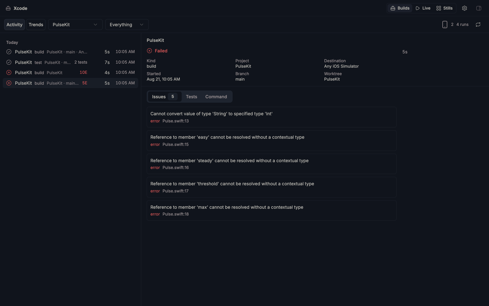
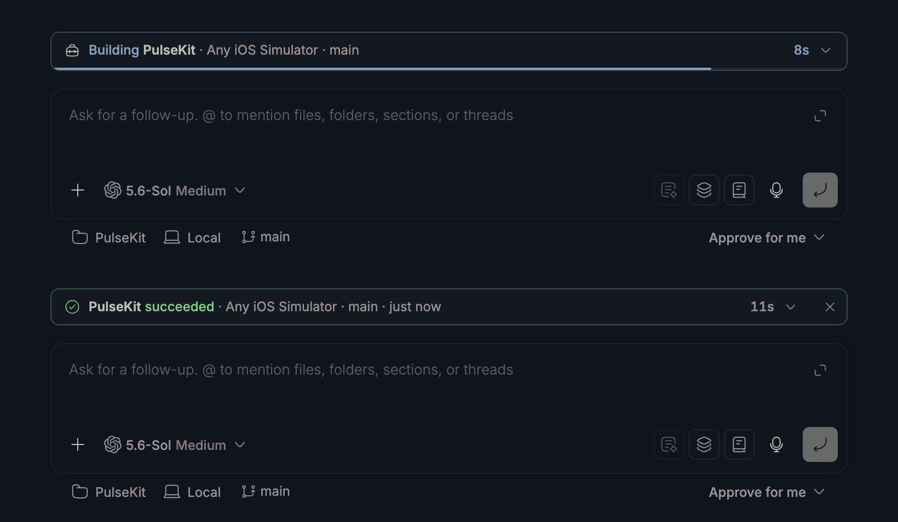
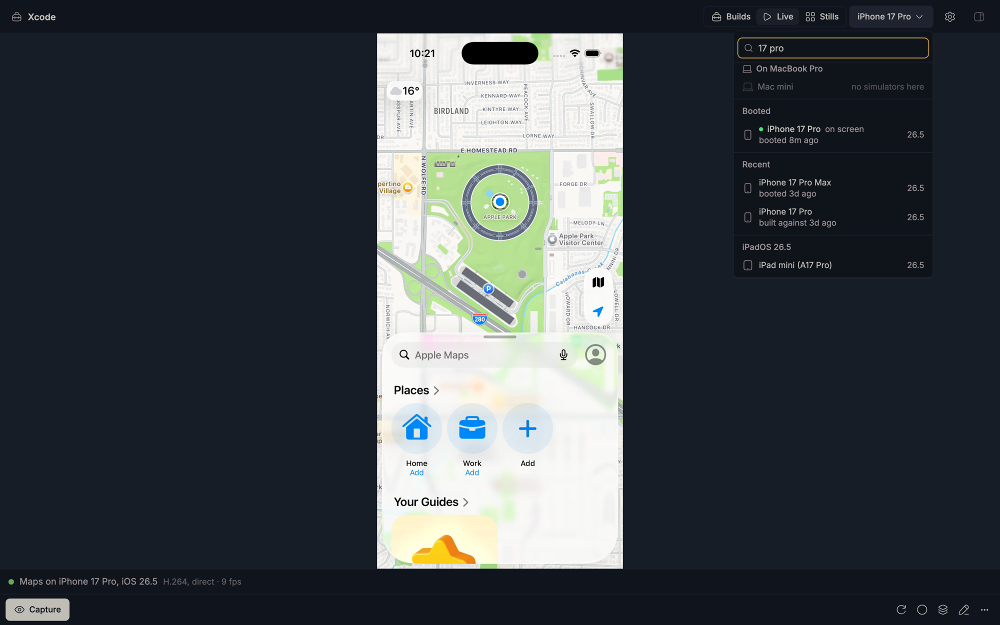
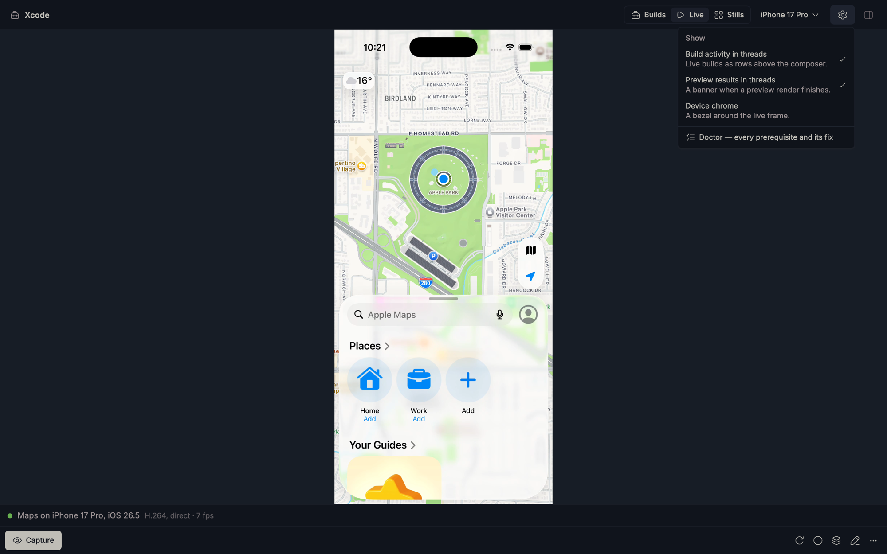
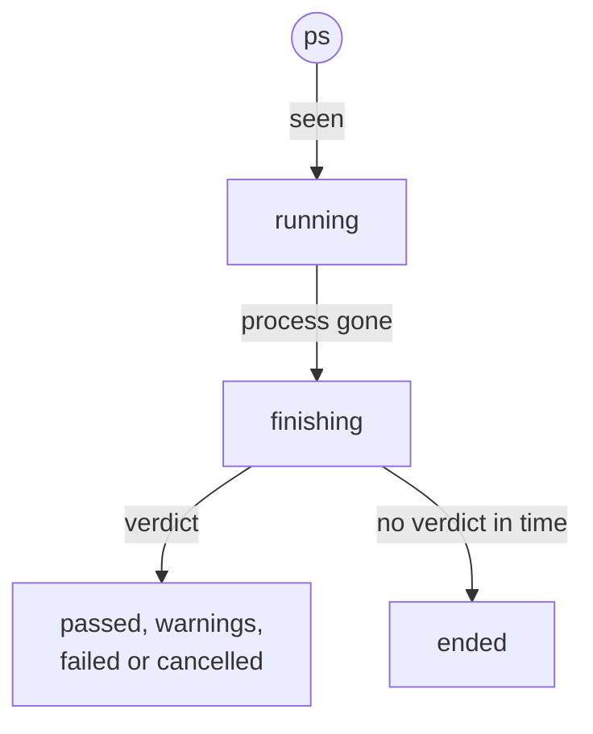

<h1 align="center">Xcode for bb</h1>

<p align="center"><b>Every Xcode build on your machine, tracked live with zero configuration,<br>and the simulators they run on, streamed and fully touchable, right in your <a href="https://getbb.app">bb</a> sidebar.</b></p>

<p align="center">
<a href="https://github.com/vburojevic/bb-plugin-xcode/releases/latest"></a>
<a href="https://getbb.app"></a>
<a href="LICENSE"></a>
<a href="https://github.com/get-bb/marketplace"></a>
</p>

<picture>
  <source media="(prefers-color-scheme: dark)" srcset="docs/hero-dark.svg">
  
</picture>

## Install

It is listed in the [BB Community marketplace](https://github.com/get-bb/marketplace), so bb installs it by name:

```sh
bb plugin install xcode
```

Or straight from this repository:

```sh
bb plugin install vburojevic/bb-plugin-xcode
```

> [!TIP]
> Plain `xcodebuild` runs only report real pass or fail when they write a result bundle. Run `bb xcode shim install` and add the `PATH` line it prints; [Getting real pass/fail](#getting-real-passfail-bb-xcode-shim) explains why.

## Highlights

<table>
<tr>
<td width="50%" valign="top">

**Zero-config build tracking**<br>
Learns DerivedData roots from the builds themselves. Xcode, `xcodebuild`, agents and CI all count.

</td>
<td width="50%" valign="top">

**Build activity in threads**<br>
Live rows above the composer while a thread's checkout builds, and a verdict card that outlives the build.

</td>
</tr>
<tr>
<td width="50%" valign="top">

**Full-touch simulator streaming**<br>
Hardware H.264, with tap, drag, flick, pinch, paste and keyboard. Momentum stays faithful even over a remote bb connection.

</td>
<td width="50%" valign="top">

**A device picker that knows your work**<br>
Booted and recently built-against devices first, searchable, with the machine named.

</td>
</tr>
<tr>
<td width="50%" valign="top">

**Stills**<br>
Every SwiftUI preview rendered and diffed against a baseline.

</td>
<td width="50%" valign="top">

**Agent tools, scoped and gated**<br>
Blocking builds with real verdicts. Simulator eyes and hands only behind an explicit setting.

</td>
</tr>
<tr>
<td width="50%" valign="top" colspan="2">

**A written-down [security model](SECURITY.md)**<br>
Loopback-only capture, allowlisted routes, and host-owned confirmations for anything destructive.

</td>
</tr>
</table>

## One panel, three tabs

### Builds



Start a build anywhere (Xcode, `xcodebuild`, an agent, a CI script wrapping either) and it appears within seconds: live progress while it runs, then the verdict, errors and failed tests with `file:line`, per-project history, and trends. Nothing to configure; the tracker learns DerivedData roots from the builds themselves.

### In threads



The activity follows the conversation. When a thread's checkout is building, the build appears as host-owned rows above that thread's composer, whether or not the agent ever mentions it, with live progress while it runs. Once everything goes quiet, the newest verdict stays as a dismissible card, so "how did that go" still has an answer after the transcript scrolls on. The gear turns the rows off if you'd rather not see them.

### Live



A booted simulator, streamed over hardware H.264 and fully interactive: tap, drag, flick, long-press, trackpad pinch, <kbd>⌘</kbd> <kbd>V</kbd> paste and the keyboard. Input ships as timestamped batches and is replayed at the finger's own pace, so a flick keeps its momentum even over a remote bb connection.

The device picker shelves what matters:

- **Booted** first, with a live dot and an *on screen* marker.
- **Recent** next: last booted *or* last targeted by one of your tracked builds, evidence Xcode's own picker does not have.
- Everything else, grouped by runtime and searchable the moment the herd grows.

It also names the machine the simulators live on. Hover a row for the UDID your next `-destination` wants.

### Stills

Every SwiftUI preview in the project, rendered on a real simulator and diffed against the last run. A visual regression net that reports itself in the panel and, when you want it to, as a banner in the thread that changed the code.

### The gear



Quick toggles for what the plugin shows in threads (build activity above the composer, preview-result banners, device chrome), plus the doctor, which lists every prerequisite and its fix. Trust-shaped settings, like whether agents may see simulator frames at all, deliberately live only in bb's own settings screen; the [security model](SECURITY.md) explains why the gear cannot touch them.

### A simulator beside any thread

A per-thread simulator also opens beside any conversation (**Open simulator** in the thread's side panel), picking its device from what that thread has actually been building, and saying why it picked it.

## Why it needs no configuration

DerivedData is not knowable in advance. It may be the shared `~/Library/Developer/Xcode/DerivedData`, a project-local `.build-sim` nested inside an SPM subpackage, or anything handed to `-derivedDataPath`. So the plugin never asks where to look. It **learns roots from the running builds**.

Every compiler invocation embeds its DerivedData root in its own arguments:

```
<ROOT>/Build/Intermediates.noindex/App.build/Debug/App.build/Objects-normal/…
```

Matching `^(.*?)/Build/(Intermediates\.noindex|Products)/` recovers `<ROOT>` from any build: Xcode.app, `xcodebuild`, `xcodebuildmcp`, CI scripts, anything. Discovered roots are persisted and watched from then on.

## The capture ladder

Each tier works alone and degrades gracefully.

| Tier | Source | Gives you | Needs |
|---|---|---|---|
| 0 | `ps` + `lsof -d cwd` | what is running now, scheme, action, destination, cwd, duration | nothing |
| 1 | `LogStoreManifest.plist` | completed runs, status, error/warning counts | nothing |
| 2 | `.xcresult` via `xcresulttool` | pass/fail, issues with file:line, per-test results | a result bundle |
| 3 | `-resultStreamPath` | live per-section progress, issues as they occur | `bb xcode run` |

A run is born from a process observation, and every later source can only add to it. Its confidence never goes backward, and its outcome is never guessed:



## Getting real pass/fail: `bb xcode shim`

> [!IMPORTANT]
> **Xcode writes no Build-domain log entry for command-line builds.** Without a result bundle, the tracker can time an `xcodebuild` run precisely but reports its outcome as **Finished** rather than guessing green.

Measured here: every DerivedData root on the machine had *zero* Build entries, only `Package` ("Resolve Packages") entries. So Tier 1, which is how Spotify's XCMetrics collects builds, yields nothing for an `xcodebuild`-driven workflow. A run's outcome is only recoverable from a `.xcresult`, and only when one was requested. To fix that everywhere:

```sh
bb xcode shim install     # confirm in bb, then add the printed PATH line
```

The shim is a ~30-line POSIX `sh` script that adds `-resultBundlePath` to build/test invocations lacking one, then hands over to the real `/usr/bin/xcodebuild` with `exec`. Queries (`-version`, `-list`, `-showBuildSettings`) pass through untouched, as does anything that already sets a bundle path. It has no dependency on bb, node, or the network, and any unexpected condition falls through to the real tool: it must never be the reason a build fails. `bb xcode shim uninstall` removes it.

## Reference

<details>
<summary><b>CLI</b>: <code>bb xcode</code> and <code>bb xcode sim</code></summary>

```sh
bb xcode status                 # what is running now
bb xcode runs [--kind test] [--limit N]
bb xcode show <run-id>          # issues + failed tests with file:line
bb xcode roots                  # discovered DerivedData roots

# Live progress + guaranteed result capture:
bb xcode run -- xcodebuild -scheme App -destination 'platform=macOS' test

# …or block until it reports:
bb xcode run --wait -- xcodebuild -scheme App test
bb xcode wait <run-id> [--timeout 600]

# The simulator half has its own verbs:
bb xcode sim            # doctor, status, devices, live, shot, drive,
                        # stills, look, history, baseline, diff, purge…
```

Simulator verbs that reveal or control device content are gated behind the `allowAgentCapture` setting, same as the agent tools.

These commands require a bb thread with a resolvable checkout, must be run from inside that checkout, and are scoped to it. A caller-selected thread or project id is rejected when it disagrees with the invoking working directory. The machine-wide history and rescan controls live in the human-owned Xcode panel. Starting or stopping a host build and changing the shim require a human confirmation rendered in the invoking thread; missing context never widens access. Agents should normally use the native `xcode_build` tool, whose thread identity is supplied by bb rather than by the CLI environment.

`run` detaches on purpose: a build's lifetime belongs to the build, not to the command that asked for it. `--wait` and `wait` only change who is *watching*. If the request disconnects or the wait times out, the build carries on and `bb xcode status` still finds it. Both exit non-zero on a failed build, so they compose with `&&`.

**Threads on another Mac.** When a thread's checkout lives on an enrolled Mac rather than on the machine running bb, `xcode_build`, `bb xcode run`, `wait` and `stop` run the build *on that Mac*, through the plugin's `bb.host` worker, which bb's daemon already runs there. The Mac needs Xcode and nothing else. The checkout boundary is checked on that Mac's disk, the confirmation sheet names the Mac, and the run shows up in the live row, `xcode_status` and `bb xcode show` with the machine's name. The build survives a plugin reload or the worker's idle stop: the worker keeps a record of each build in its data dir on that Mac and re-adopts it by pid and start time. A dropped connection does not lose it either: the run is recorded before the Mac is asked to start it, and a Mac that is asleep or offline is asked again, with backoff, until it answers, even after a night with the lid closed. The Simulators tabs still drive the simulators of the machine running bb.

**Builds on another Mac that the plugin did not start.** Builds from Xcode.app, a terminal, or Xcode's own agent tools (`BuildProject`, `RunSomeTests`, `RunProject`, which build inside Xcode.app) are *watched* on that Mac. The same probe and DerivedData sweep that run on the machine running bb run there, through the same worker. The worker reads its own `ps`, `lsof`, log stores and result bundles. Its builds show in the thread's live row, with phase, compiler count and current file, and on the plugin page, named by machine. An Xcode.app build is matched to its thread through its DerivedData root's `info.plist`, which records the workspace it builds. Nothing else about the build names the checkout. Xcode's build service shows up in `ps` only while it has compilers under it, and a test run spends minutes with none, because its runner lives in the simulator. So the action itself is read from DerivedData too. A test action creates its `Logs/Test/Test-<scheme>-<start>.xcresult` when it begins and finalizes it when it ends, and a build holds `build.db-journal` open while it runs. One RunAllTests is therefore one run, on the thread from its first seconds, with its verdict read from that bundle. Evidence that predates the running Xcode.app or its build service (a crash's unfinished bundle or journal, however quickly Xcode was reopened) is not taken for an Xcode.app action, and neither is anything in the DerivedData root a terminal `xcodebuild` is building in. When the service's Xcode.app cannot be told (two open, the service under launchd), only what began after the service started counts. A test whose service started after it can then go unseen while the service has no compilers, rather than a leftover showing as a build. A Mac is watched while a thread whose checkout is on it is active, or was active in the last 30 minutes, and for as long as a build seen there is still open. The **Always watch builds on these Macs** setting adds Macs to that set. A watched build can be followed but not stopped from bb: `bb xcode stop` says to stop it on that Mac.

</details>

<details>
<summary><b>Agent tools</b>: seven tools, scoped to the thread's checkout</summary>

| Tool | Answers |
|---|---|
| `xcode_build` | Runs xcodebuild, **waits**, returns a verdict with errors and failed tests |
| `xcode_status` | What is running now, and how this thread's recent runs finished |
| `xcode_last_failure` | Errors and failed tests from the last failure, with file:line |
| `simulator_capture` | A screenshot of the running simulator, as an image the model can see |
| `simulator_drive` | A short gesture sequence (tap by coordinates *or by accessibility label*) ending in a frame |
| `simulator_stills` | Renders every SwiftUI preview and reports what changed |
| `simulator_stream_status` | Current transport, decode and paint health for every active simulator viewer |

**The four simulator tools are off by default** and gated behind the `allowAgentCapture` setting. Captured frames go to your model provider, and that is a decision the plugin refuses to make for you. Flipping it off revokes already-registered tools on their next call.

Stream evidence is generation-scoped and correlated with `simulator_capture` in the tool's text; it never replaces or rewrites the full-resolution durable JPEG. `sourceFps` remains approximate because the current v1 AVCC stream has no source timestamps and supplies a synthetic cadence. `excessLatencyMs` is also approximate: it is viewer backlog above that viewer's best observed clock offset, never absolute end-to-end latency.

`xcode_build` exists because the alternative is worse. Telling a model to start a detached build and then check on it is telling it to write a poll loop, and `src/engine.ts` then has to recognize those loops (`WATCHER_RE`) and refuse to believe their exit codes, because `until ! bb xcode status; do sleep 5; done` exits 0 whether the build passed or failed. One blocking call removes the entire problem.

Everything an agent tool answers is scoped to the thread's own checkout, in SQL. A thread with no resolvable checkout is told exactly that rather than being handed the machine's activity.

</details>

<details>
<summary><b>Settings</b>: retention budgets</summary>

Two separate budgets, because they are two very different things.

| Setting | Default | What it holds |
|---|---|---|
| Keep history for | 30 days | Run rows, issues, per-test results (kilobytes) |
| Keep result bundles for | 2 days | `.xcresult` directory trees (hundreds of MB each) |
| Result bundle disk budget | 5 GB | Hard ceiling; oldest bundles evicted first |
| Always watch builds on these Macs | (none) | Enrolled Macs, by name, whose untracked builds are watched even with no recent thread there |

Bundle retention applies on every Mac separately: a build that ran on another Mac keeps its bundle in the plugin's data dir there, and the daily prune asks that Mac to apply the same age and budget.

Everything the tracker needs is extracted from a bundle on the first sweep, so a bundle only has to outlive the gap between the build finishing and the sweep reading it. Pointing a month of *history* retention at *bundles*, which is what a single shared setting did, meant following the shim instructions above could quietly cost tens of gigabytes. Age alone is not enough either: an afternoon of snapshot-test runs passes any sane budget well inside two days, which is what the disk ceiling is for.

</details>

<details>
<summary><b>What a live build is doing</b>: phases from the process tree</summary>

The process tree is the only progress signal available while a build runs. llbuild's own task ledger stays inside one open transaction for the whole build, so every reader sees the *previous* build's state until this one ends. A counter frozen for the duration is worse than no counter.

| Phase | Seen from |
|---|---|
| `preparing` | build service up, nothing executing: the graph is being computed |
| `resolving` | `-resolvePackageDependencies`, or `git`/`unzip` under `SourcePackages` |
| `compiling` | `swift-frontend`, `swiftc`, `clang`, `swift-plugin-server` |
| `assets` | `actool`, `ibtool(d)`, `momc`, `mapc`, `xcstringstool`, `coremlc`, `metal` |
| `linking` | `ld`, `libtool` |
| `packaging` | `dsymutil`, `strip`, `lipo` |
| `signing` | `codesign` |
| `testing` | `xctest`, `swift-testing` |

Several are alive at once as targets finish at different times, so the *latest* match wins. Reporting "compiling" while the linker is already running understates how far along a build is.

`preparing` is the only one that needs a guard, and it earns it. It is derived from "a build service with no workers", and that snapshot is identical before the first compiler spawns and after the last one exits. Measured live: a build that had already compiled, linked and signed kept re-entering that state between targets. So `Engine.livePhase` withdraws the claim once a run has been seen doing anything else, and a run adopted after a reload never gets to make it at all: its history is not ours to assume.

</details>

<details>
<summary><b>Things Xcode does that this had to work around</b></summary>

Each of these was confirmed by experiment on Xcode 26.6, not from docs.

- **The build service was renamed.** `XCBBuildService` does not exist on Xcode 26.6: `XCBuild.framework` has no XPCServices directory at all, and the service is `SWBBuildService`, inside `SwiftBuild.framework/…/PlugIns/SWBBuildService.bundle`. Command-line builds survived the rename by accident, because workers are attributed by walking up to the `xcodebuild` root and the service is just a link in that chain. An Xcode.app build, where the service *is* the root, was invisible outright.
- **`-resolvePackageDependencies` is not a metadata query.** It sat in the same ignore-list as `-version` and `-list`, which return in milliseconds. Measured here: 7m37s of fetching and unzipping prebuilt macros, during which the panel showed the thread doing nothing at all. It is now a tracked run of kind `package`, shown while it runs and dropped from history afterwards.
- **Two different epochs.** `LogStoreManifest.plist` stores Apple reference-date seconds (2001-01-01); `xcresulttool` emits Unix-epoch seconds. Confusing them shifts timestamps by ~31 years. A test asserts both converters agree on the same build.
- **Test manifests stay empty for CLI runs.** `xcodebuild test` writes *nothing* to `Logs/Test/LogStoreManifest.plist`. Per-test results exist only in the `.xcresult`, which is why Tier 2 is the sole source for them.
- **A test run's build phase writes a *Build* log entry.** Letting its status land on the run would report "succeeded" for a run whose tests failed, so that entry contributes counts only.
- **Durations are locale-formatted strings.** `get test-results tests` renders `"0,55s"` under a European locale; `parseFloat` silently returns 0.
- **Issue line numbers are 0-based** in the `sourceURL` fragment.
- **`-resultStreamPath` requires `-resultBundlePath`**, and the stream file must already exist, or xcodebuild exits 64.
- **`ps` cannot report `lstart` and `args` together** unambiguously: both contain spaces. `pid,ppid,etime,args` is the combination that parses.
- **`etime` has whole-second resolution**, so a start time derived from it drifts between ticks. Process identity is the pid alone; a composite key duplicated runs mid-build.
- **The unified log is a dead end.** `log stream` filtered to Xcode processes produced 821 lines during one build, essentially all MobileAsset/XPC noise and no build semantics.
- **`XCBBuildService` is a resident daemon**, not a per-build process. Treating its existence as a build pinned a permanent phantom entry to the panel from the moment Xcode opened. It counts only while it has compiler children.
- **A "Resolve Packages" log overlaps the build it belongs to**, sharing its DerivedData root and start time. It won correlation against the real build and reported a 5s build as 1.5s, so log domains are now gated against run kinds.
- **Hysteresis must not be billed to the build.** Ending a run at "now" after a 3-tick grace period reported a 5s build as 10.6s; runs end at the moment they were last *seen*.

</details>

<details>
<summary><b>Simulator network boundary</b></summary>

The simulator capture host binds only to an ephemeral `127.0.0.1` port. The plugin never publishes that port and has no public viewer URL or exposure command; remote simulator viewing stays inside the main bb panel through its existing same-origin plugin routes. Official remote access is owner-session-gated by bb; local `auth: "local"` routes are an Origin/CSRF boundary and accept originless same-user callers. The proxy routes are capped at four streams and four presence connections. See [SECURITY.md](SECURITY.md) for the full boundary.

</details>

<details>
<summary><b>Known limits</b></summary>

- **Another Mac is watched only while there is a reason to.** A Mac is watched while a thread whose checkout is on it is active or was in the last 30 minutes, while it is listed in **Always watch builds on these Macs**, or while a build seen there is still open. A build there outside those windows is picked up from its log store the next time that Mac is watched, so it appears in history but was never live. The machine running bb has to know its own host id (bb 0.49 provides it). Without that, no other Mac is watched.
- **The shim and extra DerivedData roots are this machine's only.** `bb xcode shim install` installs on the machine running bb, and the **Extra DerivedData roots** setting names paths there. On another Mac, a terminal `xcodebuild` without `-resultBundlePath` therefore gets its verdict only from the thread's command exit. Xcode writes no Build log entry for it, the same gap the shim fills locally. Xcode.app builds do get log entries, and test runs leave bundles in `Logs/Test`, so both get verdicts on any Mac.
- **A build on another Mac is followed through its process table, not a result stream.** An Xcode.app build there shows its phase, compiler count and current file, as one on this machine does. It has no per-section progress and no live error count: only `xcode_build` and `bb xcode run` builds have a result stream, and that is true here too.
- **Simulators and Stills drive the machine running bb.** Stills refuses a thread whose checkout is on another Mac and says so.
- **Removing the plugin does not stop builds on other Macs.** bb gives a plugin no uninstall hook, so a build in flight finishes on its own, and the plugin's data dir on that Mac stays behind, as bb leaves every plugin's host data.
- **Xcode.app (IDE) builds are not fully validated.** Everything here was verified against `xcodebuild`. IDE attribution is designed to flow from the child compilers' arguments to the DerivedData root, then from the root's `info.plist` to the workspace and the thread. That path is tested against real Xcode 26 DerivedData layouts, on this machine and on another Mac, but was not exercised against a live Xcode.app session. The `SWBBuildService` rename above was the concrete reason IDE builds could not work at all on Xcode 26. That is fixed and unit-tested, and each new build the service picks up now gets its own run. Neither is confirmed against a real IDE build yet.
- Builds shorter than the scan interval are missed by the probe, then picked up by the manifest sweep. They appear in history but never in the live strip.

</details>

<details>
<summary><b>Development</b>: tests, architecture and identity</summary>

```sh
npm install
npm test          # unit tests over the pure parsing/reconciliation logic
npm run typecheck # includes test/, so fixtures cannot drift from the types
npm run check     # both, as CI runs them
bb plugin dev     # rebuild + reload on save
```

The suite runs on Linux in CI. That is a constraint, not a convenience: every `ps`, `xcrun` and `xcresulttool` call is injected as fixture text, so the whole reconciliation layer is testable without a Mac, and a Linux runner is what keeps it honest. The one exception is the host worker's suite (`test/host-builds.test.ts`, `test/remote-builds.test.ts`): it runs the worker's real `/bin/sh` wrapper and `ps` identity checks over a fake `xcodebuild` script, through the SDK's own host-entry harness, because the exit-status file and the process group are what it is testing. Both exist on the Linux runner. The worker's watching half (`test/host-watch.test.ts`, `test/remote-watch.test.ts`) goes back to scripted `ps` text, over a temp directory laid out as Xcode lays out DerivedData.

Architecture (v2): **one run, one identity, monotonic enrichment.** A run is born from a process observation; every other source (log store, result bundle) may only *enrich* it, carrying a confidence rank (observed < logged < verified) that can never go backward. The lifecycle is explicit: running, then finishing, then passed, warnings, failed or cancelled, or a timeout to the honest terminal `ended`.

| Module | Owns |
|---|---|
| `src/model.ts` | The rules: rank lattice, lifecycle, what counts as noise |
| `src/engine.ts` | The single writer that applies them |
| `src/store.ts` | Every read and write, with the SQL scope filter |
| `src/collector.ts` | What to read and what it means: probe, discovery, manifest and bundle sweeps, for one machine |
| `src/machine.ts`, `src/observe.ts` | How a machine is read: `ps`, `lsof`, manifests, `xcresulttool` (shared with the host worker) |
| `src/remote-watch.ts` | Which other Macs are watched, and one collector per Mac through its host worker |
| `src/wrapped.ts` | Launching a build we can speak for |
| `src/launcher.ts` | Which machine a thread's build runs on |
| `src/remote.ts` | Run rows for builds on other Macs, fed by the host worker |
| `host.ts`, `src/host/` | The `bb.host` worker: validate, spawn, watch, stop and summarize builds on its Mac, and report the builds it did not start |
| `src/cli.ts`, `src/tools.ts` | The two agent-facing surfaces |
| `src/rpc.ts`, `src/dto.ts` | The two frontend-facing ones |
| `src/scope-sync.ts`, `src/thread-sync.ts` | Talking to bb about threads |
| `server.ts` | Wiring, and nothing else |

Identity is the thing to be careful with. A run is keyed by machine and pid *within one instance's lifetime*, because the tracker drops a pid the moment it leaves that machine's snapshot. Each Mac's snapshot is folded on its own, so a pid missing from one Mac's process table ends runs only on that Mac. It is not keyed by pid across a restart, where the OS may have handed that pid to something else. A re-adopted run therefore has to prove itself by reporting the start time the store expects (`ADOPTION_SLACK_MS`), or it is retired and the build genuinely holding the pid gets its own row. A bundle path, by contrast, *is* an identity, and is indexed as one.

The engine, the store and the thread reconciler are tested against a real in-memory SQLite. `test/store-scope.test.ts` asserts the SQL and in-memory scope predicates agree on the same fixtures, because two implementations of one rule is how a thread quietly stops seeing its own builds.

</details>

## More bb plugins

See every bb plugin I publish at [**vburojevic/bb-plugins**](https://github.com/vburojevic/bb-plugins).

<p align="center"><sub>Built by <a href="https://github.com/vburojevic">Vedran Burojević</a> · <a href="LICENSE">MIT</a></sub></p>
